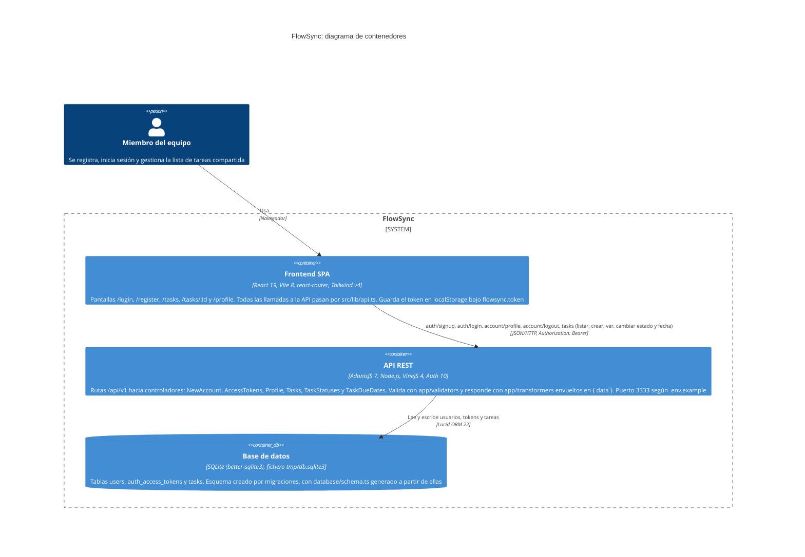

# Arquitectura de FlowSync

Diagrama de contenedores (nivel 2 de C4) de FlowSync tal como está hoy en el código. Una persona usa una SPA de React que corre en su navegador. La SPA guarda el token de sesión en `localStorage` y habla con una única API REST de AdonisJS bajo `/api/v1`. La API valida la entrada con VineJS, aplica la autenticación por access token y responde con transformers envueltos en `{ data }`. Persiste en un fichero SQLite a través de Lucid. Solo aparece lo que se ha podido comprobar leyendo `backend/start/routes.ts`, `backend/app/`, `backend/config/`, `backend/database/migrations/` y `frontend/src/`. No hay más contenedores: ni colas, ni caché, ni servicios externos, ni despliegue definido.

