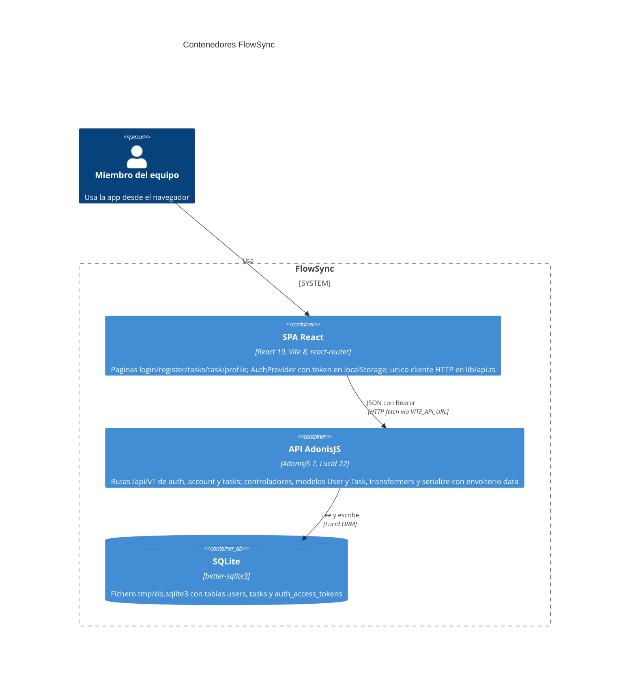

# Arquitectura de FlowSync

Diagrama de contenedores C4 del monorepo tal como está en el código: el navegador del usuario, la SPA React (`frontend/`), la API AdonisJS (`backend/`) y el fichero SQLite al que Lucid apunta. Las etiquetas citan solo piezas leídas en rutas, controladores, modelos, transformers, `lib/api.ts` y la config de base de datos.

Para verlo en local: extensión **Mermaid Chart** (`mermaidchart.vscode-mermaid-chart`). Con el fichero abierto, paleta de comandos → `Mermaid Chart: Preview` (o clic derecho → preview). El preview Markdown integrado de Cursor no siempre renderiza el dialecto `C4Container`.

