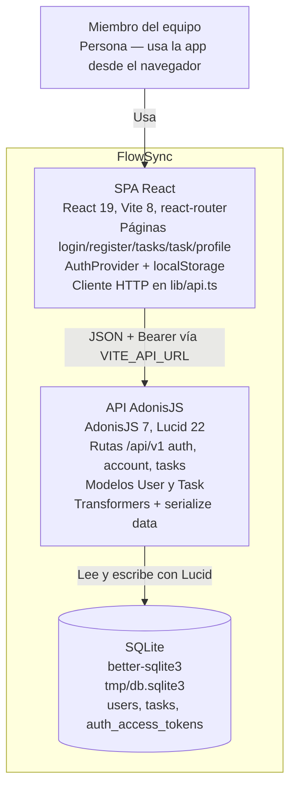

# Arquitectura de FlowSync

Diagrama de contenedores C4 del monorepo tal como está en el código: el navegador del usuario, la SPA React (`frontend/`), la API AdonisJS (`backend/`) y el fichero SQLite al que Lucid apunta. Las etiquetas citan solo piezas leídas en rutas, controladores, modelos, transformers, `lib/api.ts` y la config de base de datos. Está en `flowchart` porque el preview de Mermaid de este entorno no renderiza el dialecto `C4Container`.

